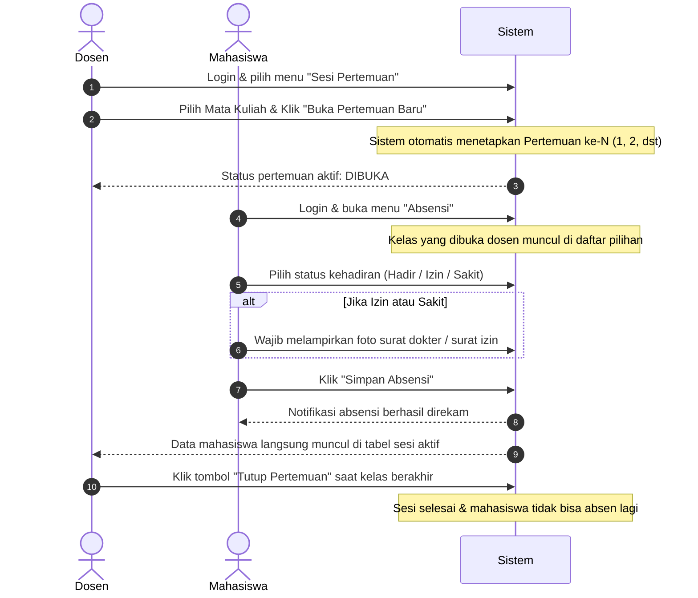

# BUKU PANDUAN PENGGUNAAN (MANUAL BOOK)
## SISTEM INFORMASI PRESENSI MAHASISWA BERBASIS WEB

---

## DAFTAR ISI
1. [Pendahuluan](#1-pendahuluan)
2. [Hak Akses & Akun Pengguna](#2-hak-akses--akun-pengguna)
3. [Alur Utama Presensi Perkuliahan](#3-alur-utama-presensi-perkuliahan)
4. [Panduan Pengguna: Mahasiswa](#4-panduan-pengguna-mahasiswa)
   - 4.1. [Login Mahasiswa](#41-login-mahasiswa)
   - 4.2. [Dashboard Mahasiswa](#42-dashboard-mahasiswa)
   - 4.3. [Melihat Jadwal Kuliah](#43-melihat-jadwal-kuliah)
   - 4.4. [Mengisi Presensi / Absensi](#44-mengisi-presensi--absensi)
   - 4.5. [Upload Surat Dokter / Bukti Izin](#45-upload-surat-dokter--bukti-izin)
5. [Panduan Pengguna: Dosen](#5-panduan-pengguna-dosen)
   - 5.1. [Login Dosen](#51-login-dosen)
   - 5.2. [Dashboard Dosen](#52-dashboard-dosen)
   - 5.3. [Membuka Pertemuan Baru](#53-membuka-pertemuan-baru)
   - 5.4. [Monitoring Presensi Masuk Real-Time](#54-monitoring-presensi-masuk-real-time)
   - 5.5. [Menutup Sesi Pertemuan](#55-menutup-sesi-pertemuan)
   - 5.6. [Rekap Absensi & Verifikasi Surat](#56-rekap-absensi--verifikasi-surat)
   - 5.7. [Melihat Laporan Kehadiran](#57-melihat-laporan-kehadiran)
6. [Panduan Pengguna: Admin (Kelola Mahasiswa)](#6-panduan-pengguna-admin-kelola-mahasiswa)
   - 6.1. [Login & Menu Admin](#61-login--menu-admin)
   - 6.2. [Menambah Mahasiswa Baru](#62-menambah-mahasiswa-baru)
   - 6.3. [Mengedit & Menghapus Mahasiswa](#63-mengedit--menghapus-mahasiswa)
7. [Panduan Menjalankan Aplikasi](#7-panduan-menjalankan-aplikasi)
8. [Tanya Jawab & Penyelesaian Masalah (FAQ)](#8-tanya-jawab--penyelesaian-masalah-faq)

---

## 1. Pendahuluan

Sistem Informasi Presensi Mahasiswa adalah aplikasi berbasis web yang dirancang untuk mendigitalisasi proses absensi perkuliahan di lingkungan kampus. Sistem ini mengintegrasikan peran **Dosen Pengampu** dan **Mahasiswa** secara terstruktur:

- **Dosen** memegang kendali penuh pembukaan sesi pertemuan kelas (Pertemuan ke-1, ke-2, ke-3, dst).
- **Mahasiswa** hanya dapat melakukan absensi jika sesi pertemuan pada mata kuliah tersebut telah dibuka oleh dosen.
- Untuk ketidakhadiran dengan alasan **Izin** atau **Sakit**, mahasiswa diwajibkan melampirkan file foto bukti dokumen pendukung (Surat Izin Orang Tua/Wali atau Surat Keterangan Sakit dari Dokter).
- Dosen dapat langsung memvalidasi dan mempratinjau (*preview*) berkas foto surat izin/sakit melalui sistem secara langsung.

---

## 2. Hak Akses & Akun Pengguna

Sistem ini mendukung beberapa jenis peran pengguna (*multi-role*). Untuk keperluan pengujian (*testing/demo*), Anda dapat menggunakan akun bawaan berikut:

| Peran (Role) | Email Login | Password Default | Keterangan |
| :--- | :--- | :--- | :--- |
| **Dosen** | `dosen@univ.ac.id` | `password` | Mengampu mata kuliah, membuka/menutup pertemuan, memvalidasi surat |
| **Mahasiswa** | `budi@student.ac.id` | `password` | Mengisi presensi kehadiran, melihat jadwal, mengunggah surat |
| **Admin** | `admin@univ.ac.id` | `password` | Akses data sistem secara menyeluruh |

---

## 3. Alur Utama Presensi Perkuliahan



---

## 4. Panduan Pengguna: Mahasiswa

### 4.1. Login Mahasiswa
1. Akses alamat web sistem di peramban (*browser*) Anda: `http://127.0.0.1:8000/login`
2. Masukkan **Email** mahasiswa (contoh: `budi@student.ac.id`) dan **Password** (`password`).
3. Centang opsi *"Ingat saya"* jika ingin menyimpan sesi login.
4. Klik tombol **Masuk**.

### 4.2. Dashboard Mahasiswa
Setelah berhasil masuk, Anda akan diarahkan ke halaman Dashboard Mahasiswa yang memuat:
- Informasi selamat datang dan NIM.
- Kartu ringkasan kehadiran: Total Kehadiran, Total Izin, Total Sakit, dan Persentase Keseluruhan.
- Riwayat absensi terbaru yang telah diinput.
- Menu navigasi samping (*sidebar*) yang responsif (termasuk tombol hamburger di perangkat seluler).

### 4.3. Melihat Jadwal Kuliah
1. Klik menu **Jadwal Kuliah** pada bilah navigasi sebelah kiri.
2. Halaman akan mengelompokkan jadwal kuliah Anda per hari (Senin, Selasa, Rabu, Kamis, Jumat, Sabtu).
3. Anda dapat memeriksa:
   - Kode dan Nama Mata Kuliah.
   - Dosen Pengampu.
   - Jam Perkuliahan (Waktu Mulai - Waktu Selesai).
   - Ruang Kelas.

### 4.4. Mengisi Presensi / Absensi
1. Klik menu **Absensi** pada bilah navigasi samping.
2. Di bagian formulir **Input Presensi**:
   - Pilih **Mata Kuliah**: Sistem hanya akan menampilkan mata kuliah yang pertemuannya **sedang dibuka oleh Dosen**. Jika dosen belum membuka pertemuan, kelas tidak akan muncul di opsi ini.
   - Periksa **Nomor Pertemuan**: Nomor pertemuan terisi secara otomatis mengikuti sesi yang sedang aktif.
   - Pilih **Status Kehadiran**:
     - **Hadir**: Mahasiswa hadir mengikuti perkuliahan.
     - **Izin**: Mahasiswa berhalangan hadir dengan alasan izin sah.
     - **Sakit**: Mahasiswa berhalangan hadir karena kondisi medis/sakit.
   - Isi **Keterangan Tambahan** (opsional untuk hadir, dianjurkan untuk izin/sakit).

### 4.5. Upload Surat Dokter / Bukti Izin
Jika Anda memilih opsi status **Izin** atau **Sakit**, formulir akan menampilkan kolom upload berkas:
1. Kolom berkas berlabel:
   - *"Unggah Bukti Surat Dokter (Wajib untuk Sakit)"* saat memilih Sakit.
   - *"Unggah Bukti Surat Izin (Wajib untuk Izin)"* saat memilih Izin.
2. Klik tombol input file dan pilih dokumen foto surat (Format didukung: `.jpg`, `.jpeg`, `.png`, maksimal 2MB).
3. Klik tombol **Simpan Absensi**.
4. Setelah berhasil, data presensi Anda akan tercatat dalam tabel **Riwayat Kehadiran Anda** di bagian bawah halaman.

---

## 5. Panduan Pengguna: Dosen

### 5.1. Login Dosen
1. Buka halaman login di `http://127.0.0.1:8000/login`.
2. Masukkan **Email Dosen** (`dosen@univ.ac.id`) dan Password (`password`).
3. Klik tombol **Masuk**.

### 5.2. Dashboard Dosen
Dashboard dosen menampilkan:
- Nama Dosen dan NIDN.
- Statistik cepat: Total Mata Kuliah yang diampu, Total Pertemuan Selesai, dan Rata-rata Kehadiran Mahasiswa.
- Daftar mata kuliah yang diampu beserta jadwal dan jam mengajarnya.

### 5.3. Membuka Pertemuan Baru
Untuk memulai perkuliahan agar mahasiswa dapat mengisi presensi:
1. Klik menu **Sesi Pertemuan** pada sidebar.
2. Pada panel **Buka Pertemuan Baru**:
   - **Pilih Mata Kuliah**: Pilih mata kuliah yang akan dimulai dari dropdown.
   - **Nomor Pertemuan (Otomatis)**: Sistem otomatis membaca riwayat pertemuan sebelumnya dan menampilkan nomor pertemuan berikutnya (misalnya Pertemuan ke-1, ke-2, ke-3, dst). Dosen tidak perlu mengetikkan angka manual.
   - **Topik / Materi Kuliah (Opsional)**: Masukkan ringkasan topik bahasan hari ini (contoh: *"Pengenalan Database Relasional"*).
3. Klik tombol **Buka Pertemuan Baru**.
4. Sesi kelas akan berstatus **DIBUKA** (*Aktif*).

### 5.4. Monitoring Presensi Masuk Real-Time
Pada panel **Pertemuan Yang Sedang Aktif**:
- Dosen dapat melihat kartu ringkasan mahasiswa: Total Absen, Jumlah Hadir, Jumlah Izin, dan Jumlah Sakit.
- Tabel daftar mahasiswa yang masuk akan terisi secara otomatis seiring mahasiswa mengirimkan absensinya.
- Apabila mahasiswa memilih Izin/Sakit dan mengunggah foto surat, muncul tombol **Lihat** di kolom Bukti Surat. Klik tombol tersebut untuk membuka jendela *pop-up modal* tampilan dokumen surat dokter/izin yang bersangkutan.

### 5.5. Menutup Sesi Pertemuan
1. Ketika jam perkuliahan selesai, klik tombol **Tutup Pertemuan** pada kotak pertemuan aktif terkait.
2. Konfirmasi dialog pertanyaan yang muncul (*"Apakah Anda yakin ingin menutup pertemuan ini?"*).
3. Setelah ditutup:
   - Mahasiswa tidak dapat lagi mengisi presensi untuk pertemuan tersebut.
   - Data pertemuan dipindahkan ke tabel **Riwayat Pertemuan Yang Telah Ditutup**.

### 5.6. Rekap Absensi & Verifikasi Surat
1. Klik menu **Rekap Absensi**.
2. Pilih mata kuliah yang ingin diperiksa, lalu klik **Tampilkan**.
3. Sistem akan menyajikan:
   - **Tabel Persentase Kehadiran**: Rekapitulasi per nama mahasiswa beserta rincian Hadir, Izin, Sakit, Alpa, Total, dan *progress bar* persentase kehadirannya.
   - **Riwayat Detail Kehadiran & Bukti Surat**: Tabel kronologis setiap absensi mahasiswa. Untuk memvalidasi alasan ketidakhadiran, klik tombol **Lihat Surat** untuk memeriksa foto surat keterangan dokter/izin langsung di layar.

### 5.7. Melihat Laporan Kehadiran
1. Klik menu **Laporan** pada bilah navigasi.
2. Anda dapat melihat ringkasan performa kehadiran seluruh kelas:
   - Rata-rata persentase kehadiran per mata kuliah.
   - Indikator warna (*Hijau* $\ge 75\%$, *Kuning* $50\% - 74\%$, *Merah* $< 50\%$).

---

## 6. Panduan Pengguna: Admin (Kelola Mahasiswa)

Peran Administrator memiliki hak akses khusus untuk mengelola master data mahasiswa dan mata kuliah yang diikutinya.

### 6.1. Login & Menu Admin
1. Buka halaman login di `http://127.0.0.1:8000/login`.
2. Masukkan email Administrator (`admin@univ.ac.id`) dan kata sandi (`password`).
3. Sistem secara otomatis mengarahkan admin ke halaman **Kelola Data Mahasiswa** (`/admin/mahasiswa`).
4. Di bilah menu navigasi (*sidebar*), terdapat menu khusus **Kelola Mahasiswa**.

### 6.2. Menambah Mahasiswa Baru
1. Pada halaman Kelola Data Mahasiswa, klik tombol **+ Tambah Mahasiswa**.
2. Jendela formulir modal akan terbuka. Isi data mahasiswa:
   - **NIM**: Nomor Induk Mahasiswa (unik).
   - **Kelas**: Kode kelas (contoh: *TI-A*, *TI-B*, *TI-C*).
   - **Nama Lengkap**: Nama lengkap mahasiswa.
   - **Email Akun**: Alamat email yang digunakan mahasiswa untuk login.
   - **Password**: Kata sandi awal (jika dikosongkan, sistem otomatis menetapkan `password`).
   - **Program Studi**: Program studi mahasiswa (contoh: *Teknik Informatika*).
   - **Pilih Mata Kuliah**: Centang mata kuliah yang diambil oleh mahasiswa bersangkutan.
3. Klik tombol **Simpan Mahasiswa Baru**.
4. Akun mahasiswa langsung aktif dan dapat digunakan untuk login ke sistem.

### 6.3. Mengedit & Menghapus Mahasiswa
- **Pencarian & Filter**: Gunakan kotak input pencarian (berdasarkan nama, NIM, atau email) serta filter dropdown kelas untuk mempermudah menemukan mahasiswa.
- **Mengedit Data**:
  1. Klik tombol **Edit** pada baris mahasiswa yang bersangkutan.
  2. Ubah data yang diinginkan (termasuk mengganti password atau memperbarui daftar mata kuliah).
  3. Klik tombol **Simpan Perubahan**.
- **Menghapus Mahasiswa**:
  1. Klik tombol **Hapus** pada baris mahasiswa.
  2. Sistem akan menampilkan dialog konfirmasi keamanan.
  3. Klik *OK* untuk menghapus mahasiswa beserta data absensi terkait dari sistem.

---

## 7. Panduan Menjalankan Aplikasi

Jika Anda ingin menjalankan atau memindahkan aplikasi ini di komputer lain, ikuti langkah berikut:

### Prasyarat
- PHP versi 8.2 atau lebih baru
- Composer
- SQLite atau MySQL
- Web Browser modern (Chrome, Edge, Firefox)

### Langkah Instalasi
```bash
# 1. Buka terminal pada folder proyek
cd "c:\tugas kuliah\movik\absensi_mahasiswa"

# 2. Install dependensi composer
composer install

# 3. Buat file environment jika belum ada
copy .env.example .env
php artisan key:generate

# 4. Jalankan migrasi dan seeder database awal
php artisan migrate --seed

# 5. Buat symlink untuk storage berkas upload surat bukti
php artisan storage:link

# 6. Jalankan server lokal
php artisan serve
```

Aplikasi siap diakses melalui browser di alamat:
**`http://127.0.0.1:8000`**

---

## 8. Tanya Jawab & Penyelesaian Masalah (FAQ)

**T: Mengapa mata kuliah tidak muncul di pilihan absensi mahasiswa?**  
**J:** Mahasiswa hanya dapat absen jika Dosen telah mengklik tombol **"Buka Pertemuan Baru"** pada menu *Sesi Pertemuan*. Pastikan dosen telah membuka sesi perkuliahan pada hari tersebut.

**T: Bagaimana jika mahasiswa sakit atau izin tetapi tidak mengunggah surat dokter?**  
**J:** Sistem akan memvalidasi agar mahasiswa melampirkan berkas bukti dokumen. Jika mahasiswa belum mengunggah, formulir akan mengingatkan mahasiswa untuk melampirkan foto dokumen pendukung.

**T: Apakah penomoran pertemuan bisa lompat atau salah ketik?**  
**J:** Tidak. Penomoran pertemuan diatur secara otomatis berurutan oleh sistem (Pertemuan 1, 2, 3, dst.) berdasarkan data riwayat pertemuan mata kuliah yang bersangkutan di database.

**T: Bagaimana cara melihat foto surat dokter dalam ukuran aslinya?**  
**J:** Pada jendela pratinjau surat di akun Dosen, klik tombol **"Buka Gambar Asli"** di pojok bawah modal untuk melihat foto dalam tab baru dengan resolusi penuh.

---
*Manual Book ini disusun sebagai dokumentasi resmi Sistem Informasi Presensi Mahasiswa.*
